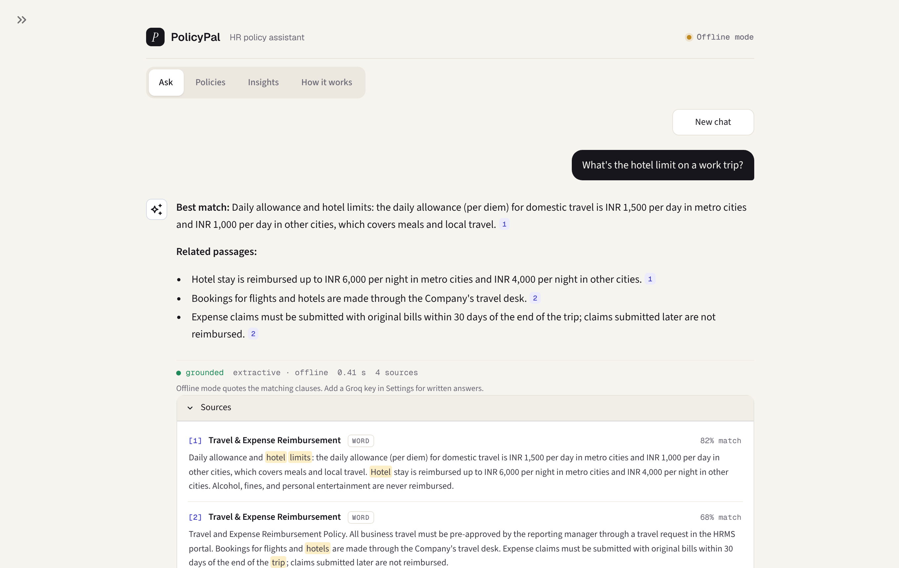
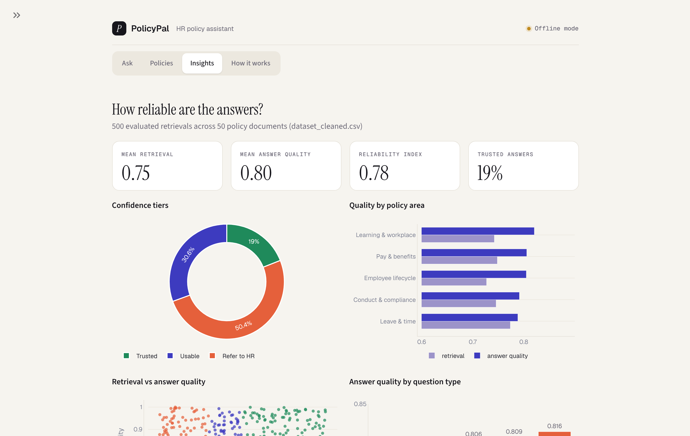

# PolicyPal — HR policy assistant

**RAG-Based Document Q&A System** · HCLTech Career Shaper Programme 2025-26 · Project No. 72 · Domain: LLM / Python

PolicyPal answers employees' HR questions (leave, pay, travel, conduct, exit) from the company handbook. Every answer is generated **only** from retrieved policy clauses, and each claim is cited back to its source. You can also upload your own PDF or Word policy and ask questions about it.



## Features

- **Ask**: chat-style Q&A. Hybrid retrieval (BM25 + ChromaDB vectors), a grounded prompt, and an LLM answer with `[n]` citations. The source clauses are shown under every answer, and questions outside the handbook get "not found".
- **Add document**: upload PDF, Word (.docx), TXT, Markdown or HTML. It is chunked and indexed instantly.
- **Policies**: browse the built-in handbook (15 policies of a fictional company, Orbitline Technologies) by category.
- **Insights**: analysis of `data/dataset_cleaned.csv` (confidence tiers, quality by policy area, retrieval vs answer quality) and a live retriever benchmark (Hit@1, Hit@3, MRR, latency).
- **How it works**: the pipeline, the stack, the guardrails and the exact prompt template.
- **LLM providers**: Groq (free tier, default), Grok (xAI), OpenAI or local Ollama, through one OpenAI-compatible client. Without a key, an offline extractive mode still answers with citations.



## Tech stack

| Layer | Technology |
|---|---|
| UI | Streamlit |
| Chunking | LangChain `RecursiveCharacterTextSplitter` (700 chars, 100 overlap) |
| Retrieval | ChromaDB (all-MiniLM-L6-v2) + BM25 (`rank-bm25`), score = 0.6 × BM25 + 0.4 × cosine |
| LLM | Groq (Llama 3.3 70B) / Grok / OpenAI / Ollama via the `openai` SDK |
| Parsing | pypdf, python-docx |
| Charts | Plotly |

## Project structure

```
app.py                  Streamlit app (Ask, Policies, Insights, How it works)
rag/engine.py           RAG pipeline: ingestion, hybrid index, prompt, generation, extractive fallback, benchmark
data/corpus.json        Built-in HR handbook (15 policies, 61 clauses) + 16-question benchmark
data/dataset.csv        Project dataset (500 rows x 7 columns)
data/dataset_cleaned.csv, data/data_dictionary.csv   Cleaned dataset and column descriptions
.streamlit/config.toml  Theme
.streamlit/secrets.toml.example   Template for the API key
```

## Getting started

Requires Python 3.10–3.12.

```bash
git clone https://github.com/SARPAT/cspace_app.git
cd cspace_app
python -m venv .venv
# Windows:     .venv\Scripts\activate
# macOS/Linux: source .venv/bin/activate
pip install -r requirements.txt
streamlit run app.py
```

The app opens at <http://localhost:8501>. The first start downloads a small embedding model.

## Configuration

Open **Settings** (the arrow at the top left), choose a provider and paste its API key (kept only for that session), or store it in `.streamlit/secrets.toml`:

```toml
GROQ_API_KEY = "your-key"     # Groq (free at console.groq.com)
# XAI_API_KEY = "your-key"    # Grok (xAI)
# OPENAI_API_KEY = "your-key" # OpenAI
```

`secrets.toml` is git-ignored. The model list is loaded live from the provider.

## Ethics

The model is told to use only the retrieved clauses and to say when the policy is silent, and the source clauses are always shown beside the answer. PolicyPal is not legal advice; HR has the final word. API keys live only in server secrets or the user's session, and uploads stay in memory.

## Credits

Saransh Patel (Roll No. 2300320120225) · Mentor: Sir S.P Gautam · ABES Engineering College · 2026
